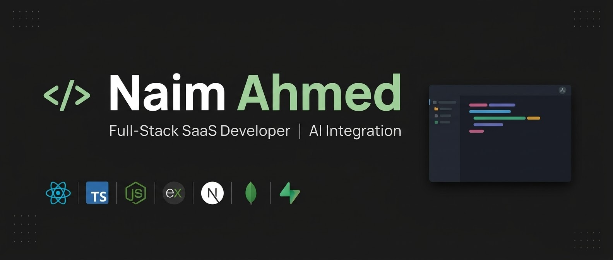

<h1 align="center">Hi, I'm Naim Ahmed 👋</h1>

  

---

## 👨‍💻 About Me

I'm a developer who enjoys learning new technologies, solving problems, and turning ideas into practical software. I focus on building full-stack web applications, SaaS products, and AI-powered solutions. I believe in continuous learning and improving through hands-on projects.

---

## 🛠️ Skills & Technologies

**Frontend:** HTML, CSS, JavaScript, React, Tailwind CSS, Bootstrap

**Backend:** Node.js, Express.js, REST APIs

**AI & Automation:** Python, AI API Integration

**Tools:** Git, GitHub, VS Code

### Most Used Languages

  

---

## 📊 GitHub Statistics

  

  

---

### 💼 Business Inquiries

